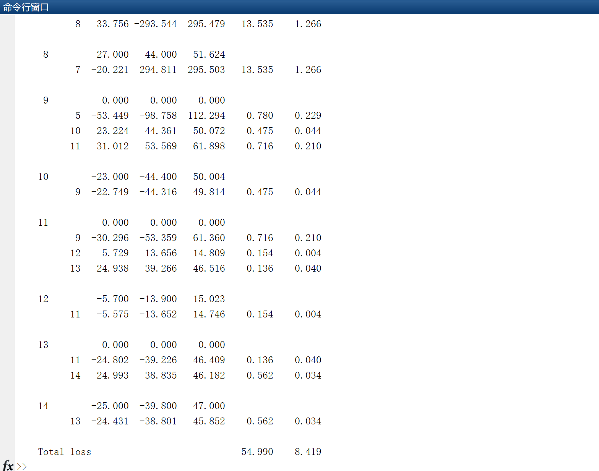

# Microgrid Flow Analysis (Matlab Code Implementation)

Microgrid Flow (Matlab Code Implementation)
This article only displays a subroutine code and its running results:
%Newton-Raphson method and Gauss-Seidel method are used together for the calculation of line flow and line loss. \nSLT = 0; \nfprintf('\n')\nfprintf('                           Line Flow and Losses \n\n')\nfprintf('     --Line--  Power at bus & line flow    --Line loss--  Transformer\n')\nfprintf('     from  to    kW      kvar     kVA       kW      kvar      tap\n')\nfor n = 1:nbus\nbusprt = 0; \n   for L = 1:nbr; \n       if busprt == 0\n       fprintf('   \n'), fprintf('%6g', n), fprintf('      %9.3f', P(n)*basemva)\n       fprintf('%9.3f', Q(n)*basemva), fprintf('%9.3f\n', abs(S(n)*basemva))\n\n\n       busprt = 1; \n       else, end\n       if nl(L)==n      k = nr(L); \n       In = (V(n) - a(L)*V(k))*y(L)/a(L)^2 + Bc(L)/a(L)^2*V(n); \n       Ik = (V(k) - V(n)/a(L))*y(L) + Bc(L)*V(k); \n       Snk = V(n)*conj(In)*basemva; \n       Skn = V(k)*conj(Ik)*basemva; \n       SL  = Snk + Skn; \n       SLT = SLT + SL; \n       elseif nr(L)==n  k = nl(L); \n       In = (V(n) - V(k)/a(L))*y(L) + Bc(L)*V(n); \n       Ik = (V(k) - a(L)*V(n))*y(L)/a(L)^2 + Bc(L)/a(L)^2*V(k); \n       Snk = V(n)*conj(In)*basemva; \n       Skn = V(k)*conj(Ik)*basemva; \n       SL  = Snk + Skn; \n       SLT = SLT + SL; \n       else, end\n         if nl(L)==n | nr(L)==n\n         fprintf('%12g', k),\n         fprintf('%9.3f', real(Snk)), fprintf('%9.3f', imag(Snk))\n         fprintf('%9.3f', abs(Snk)),\n         fprintf('%9.3f', real(SL)),\n             if nl(L) ==n & a(L) ~= 1\n             fprintf('%9.3f', imag(SL)), fprintf('%9.3f\n', a(L))\n             else, fprintf('%9.3f\n', imag(SL))\n             end\n         else, end\n  end\nend\nSLT = SLT/2; \nfprintf('   \n'), fprintf('    Total loss                         ')\nfprintf('%9.3f', real(SLT)), fprintf('%9.3f\n', imag(SLT))\nclear Ik In SL SLT Skn Snk\n\n\n\n        \n

## Images

<!-- PAYMENT_BLOCK -->

## Get this dataset

- Payment link (Stripe): [Buy now](https://buy.stripe.com/3cs8yP7sY87d0vu9AB)
- Payment QR code: 

<!-- /PAYMENT_BLOCK -->
